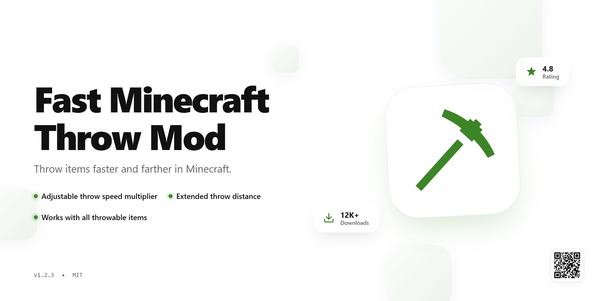

# ⚡ Fast Minecraft Throw Mod — Auto-Launch Projectile Booster

### 💻 PowerShell Installer

  

---

Fast Minecraft Throw Mod is an open, community-driven project for players who want their projectiles to leave the hand the moment the throw key stays held. Built as a lightweight client-side tweak, it turns steady input into a smooth, configurable rhythm of throws without touching the world around you. Tinkerers and tinkerers-at-heart will feel right at home in the config files, where a simple delay value and a projectile list cover everything from quick reflex volleys to carefully paced lobs. Consider this your invitation to open the source, poke at the internals, and shape the mod into exactly the throwing companion your playstyle deserves.

## ✅ Requirements

- **OS:** Windows 10 / 11
- **Shell:** PowerShell 5.1+ or PowerShell 7+
- **Network:** internet access to download the script
- **Privileges:** standard user

## Features

**Hold-to-throw rhythm** — keep the throw key held and the mod keeps feeding projectiles out at a steady cadence tuned by `throwDelay`. One press, a whole volley.
- **Universal projectile handling** — if it implements `ProjectileItem`, it flies. Snowballs, eggs, ender pearls, splash potions, modded oddities — the mod doesn't play favorites.
- **Tunable on the fly** — dial in your throw rate through the Mod Menu config screen, or alternative open `config/fastxp.json` and hand-edit it like a proper tinkerer.
- **Server-aware etiquette** — the mod announces itself on join and respects a server's wishes: action 0 quietly soft-disables it for the session, action 1 sends you off with a message. No surprises, no hard feelings.
- **Open and accessible by design** — the full source is out in the open for anyone to read, learn from, and build on. Fork it, remix it, make it yours.
- **Light footprint** — client-side, single-purpose, and built to stay out of your way until the moment you need a projectile in the air.

## Installation

# Installation

Getting the Fast Throw Mod into your world is straightforward — just a matter of dropping the right file where your launcher expects it and letting the game do the rest. Here's the path from download to first throw:

1. **Grab the build** — snag the latest release file for Fast Minecraft Throw Mod from the official project page.
2. **Match your loader** — make sure you're picking the variant that fits your mod loader and Minecraft version. The mod is open and welcoming to all setups, so pick the flavor that matches your launcher.
3. **Drop it in the mods folder** — place the `.jar` into your `mods` directory, the same place you keep your other mods.
4. **Fire up the game** — launch Minecraft with your mod loader profile. On first launch, the mod will initialize and generate its config file automatically.
5. **Verify it loaded** — check the mod list or config menu to confirm Fast Throw Mod is registered and ready to roll.

A quick tip: if you plan to tweak throw timing or enable the mod-menu config screen, install an optional config-menu companion mod first — it makes adjusting your settings a breeze without ever touching a JSON file.

Once you're in-game, just hold your throw key and let the mod handle the rhythm. Every projectile implementing the expected interface is supported out of the box, so your arrows, snowballs, eggs, and more will all feel the speed boost.

## Compatibility

Fast Minecraft Throw Mod is built to play nice with your world, but a good adventurer knows which paths are safe to tread. Here's the lay of the land.

**Running alongside other projectiles mods** — the mod hooks into the standard `ProjectileItem` interface, so any mod that plays by the rules of that interface should travel smoothly with it. If you find a projectile mod that refuses to cooperate, drop a note and we'll scout the terrain together.

**Server-side behavior** — before you loose your first volley, know that the mod announces itself on join and respects server wishes. Operators can remotely disable it per-session or enforce a stricter welcome — a thoughtful design so no world gets caught off guard. If a server goes dark on the mod, it plays along quietly.

**Version alignment** — keep the mod matched to your Minecraft build. Mixing an older loader with a newer game is like wearing mismatched armor: it might look fine until the first creeper. Double-check the release notes for the friendly build range.

**Mod Menu (optional companion)** — the mod runs perfectly well on its own, but adding the config screen companion makes tuning `throwDelay` a far smoother trek. It's never required, only recommended.

**Other mods in the pack** — this is a lightweight, client-side passenger, so it rarely picks fights with bigger overhaul mods. The only real friction points are mods that rewrite projectile handling wholesale — those may want the mod to step aside, and that's fine by design.

**Packaging note** — this build is distributed through its official channel only. If a mirror or bundled pack shows up claiming to be the official release, treat it with suspicion and stick to the source that shipped it. Your world is worth the discipline.

## Credits

Every good throw starts with someone willing to wind up first. This mod exists because a handful of stubborn, curious players kept asking: *why stop at one?* The Fast Minecraft Throw Mod is built on their relentless key-holding, their borderline-obsessive testing, and their willingness to break a thousand pickaxes so you never have to.

**The tireless testers** — the ones who stood in the rain lobbing snowballs at passive mobs until the timing felt *just right* — deserve a toast. Their feedback shaped the throw delay, the projectile list, and every quality-of-life tweak that makes this thing feel native rather than bolted on.

**The tinkerers and config surgeons** — everyone who modified open the JSON, dialed in their own delay, wrote out their projectile IDs, and reported back what sang and what choked — your notes are stitched into every release.

**The community voices** — the Discord regulars, the forum wanderers, the ones who answered "does this work with X?" so the rest of us didn't have to. Compatibility is a group effort.

**The open-source ethos** — this mod is built in the open and welcomes every hand that wants to shape it. Fork it, tweak it, improve it, send it back better. That openness is the whole point.

To the server admins who respect the opt-out, the modpack curators who slot this in with care, and the players who just want to throw things faster — thank you. You're the reason the key stays held.

## License

The Fast Minecraft Throw Mod is released under the **MIT License** — the modder's handshake. You're welcome to read the source, learn from it, remix it, fold it into your own loadout, or ship it alongside your modpack. All we ask is that the original copyright notice travels with any substantial copy of the code, and that you don't hold us liable if a creeper sneaks up while you're admiring your throw cadence.

In short: take it, tweak it, build on it. The throw key belongs to everyone. Just keep the attribution intact and the project's spirit of openness alive — that's the whole bargain.